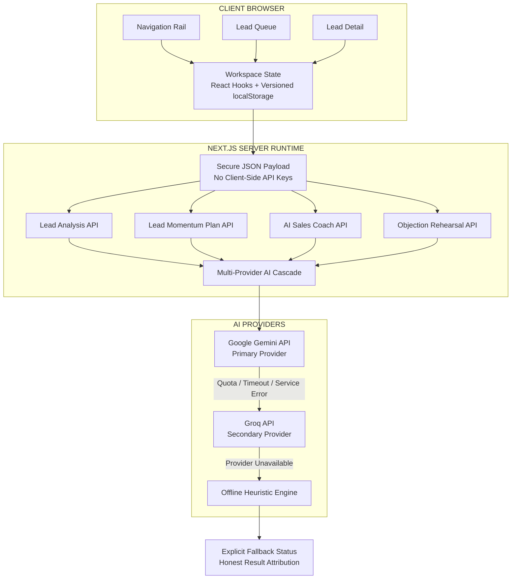

# LeadMotive — Real Estate Lead Intelligence

> AI-Powered Real Estate Lead Intelligence. Know which buyer to move next. Know what to say.

LeadMotive is an enterprise-grade sales intelligence workbench designed for high-velocity real estate markets. It solves the critical triage bottleneck in high-ticket property sales: helping sales representatives decide who to call within the golden 15-minute window, uncovering hidden buyer anxieties (pricing per sqft, RERA delivery delays, A-Khata legal validity), and enabling reps to rehearse objections before dialing.

---
<p align="left">
  <a href="https://iqol-six.vercel.app/"><strong>Live application</strong></a> ·
  <a href="https://iqol-six.vercel.app/workspace"><strong>Open workspace</strong></a> ·
  <a href="https://github.com/tharun242005/LeadMotive"><strong>Source repository</strong></a>
</p>

> **Demo-data and privacy notice:** The included lead examples are synthetic. The current application stores leads and plan progress in browser `localStorage`; it does not provide a shared, server-side customer database. Do not enter real customer personal, financial, or otherwise sensitive information into a demo deployment. Model-generated property details, availability, prices, legal information, financial estimates, and possession dates must be independently verified before being communicated to a customer.

## What LeadMotive Solves

1. **Lead Triage Bottleneck**: Real estate teams receive dozens of raw inquiries daily. Reps waste hours manually skimming messages to guess urgency. LeadMotive calculates a 0ms deterministic priority score (0–100) instantly categorizing leads into **Act Now**, **Follow Up**, and **Nurture** bands.
2. **Hidden Buyer Objections**: Inbound inquiries often hide real objections behind casual inquiries. LeadMotive leverages server-side Google Gemini models to extract structured intent, specific property requirements, and grounded objection quotes verified against raw text.
3. **Execution Hesitation & Cold Calls**: Salespeople often enter calls cold and falter when prospects push back on price or possession timelines. LeadMotive’s signature **Objection Rehearsal Studio** allows reps to simulate conversations with an AI buyer and receive structured 4-dimension coaching debriefs before picking up the telephone.

---

## Screens & Major Workflows

| Screen / Feature | Path | Key Capabilities |
|---|---|---|
| **Public Homepage** | `/` | Comprehensive product landing page, interactive canonical lead preview, transparent 4-factor scoring breakdown, and the Lead Momentum Plan showcase (`#momentum`). |
| **Sales Workbench** | `/workspace` | 3-pane sales intelligence workspace: searchable & filterable lead queue, scannable AI analysis card, grounded objection quotes, copyable WhatsApp drafts, and Deal Velocity timeline. |
| **Contextual AI Coach** | `/workspace` (Right Pane) | Lead-specific co-pilot answering sales questions ("Give me a 30s call opener", "Why Hot rather than Warm?", "Handling financing concerns") with 100% context isolation. |
| **Objection Rehearsal Studio** | `/workspace` (Rehearsal Modal) | Interactive practice arena: AI simulates the buyer's persona voicing authentic resistance; upon completion, generates a 4-dimension coaching debrief (1–5 rubric). |
| **Lead Momentum Plan Studio** | `/workspace/momentum` | Dynamic 3–10 step sequential action roadmaps with pre-flight fact-check chips, personalized WhatsApp/email drafts, decision branches, and progress tracking with history preservation. |

---

## Architecture Overview


---

## AI Model & Multi-Provider Cascade Details

- **Official SDK**: `@google/genai` (v2.30.0).
- **Primary Model**: `gemini-3.5-flash-lite` (Google's multimodal Flash-Lite class model for high-throughput structured output). Configurable via server environment variable `GEMINI_MODEL`.
- **Secondary Failover Provider**: Groq Cloud REST API via `openai/gpt-oss-20b` (`GROQ_API_KEY`, `GROQ_MODEL`). Automatically activated if Gemini returns HTTP 429 (quota exhaustion/rate limits), times out, or encounters transient service errors.
- **Final Heuristic Fallback**: Deterministic Bengaluru Heuristic Engine, guaranteeing zero unhandled 500 errors and providing full-fidelity structured outputs even in complete offline mode.
- **Provider Cascade Order**: `Google Gemini` (Primary) → `Groq` (Secondary) → `Deterministic Heuristics` (Final Fallback). Never silently labels heuristic data as live AI.
- **Server-Only Invocation**: All AI requests originate strictly from Next.js server route handlers (`src/app/api/leads/*`). Zero client-side API keys exist, and no secrets are exposed to the browser.
- **Untrusted Input Shielding**: Raw customer inquiry text is isolated inside triple quotes (`"""`) with strict anti-override system instructions preventing prompt injections.
- **Verbatim Quotation Grounding**: Extracted objection evidence is compared against the original customer submission. If not an exact verbatim match, it is flagged with `[Unverified Quote]` to eliminate hallucinated evidence.
- **Honest Multi-Provider Telemetry**: Every response includes an `AIMetadata` header exposing:
  - `provider`: `"google-gemini"` | `"groq"` | `"offline-heuristic"`
  - `model`: The model that actually generated the response (e.g. `"gemini-3.5-flash-lite"`, `"openai/gpt-oss-20b"`, or `null`)
  - `mode`: `"live"` | `"fallback"`
  - `fallbackUsed`: `boolean` (strictly `false` when a live model succeeds)
  - `secondaryUsed`: `boolean` (`true` when failed over to Groq)
  - `primaryFailureReason`: Detailed failure code (`"gemini_timeout"`, `"gemini_quota_exceeded"`, `"gemini_invalid_key"`, etc.)
  - `fallbackReason`: Root failure code triggering the fallback
  - `latencyMs`: Precise round-trip execution duration
- **Measured Latency & Execution Budget**:
  - **Deterministic 4-Factor Scoring**: **< 1ms / instant** (client-side pure math).
  - **Live AI Structured Generation**: Measured at **8–14 seconds** on `gemini-3.5-flash-lite` for full 2,000-token structured roadmaps with multi-branch logic, protected by a 20,000ms timeout.
  - **Conversational AI Coach & Rehearsal**: Measured at **2–4 seconds** for interactive roleplay turns.
  - **Vercel Execution Headroom**: API route handlers export `export const maxDuration = 45;` (and `maxDuration = 20;` for diagnostics), ensuring that the primary Gemini call (20s) plus optional Groq failover (12s) execute comfortably within hosting platform limits without 504 gateway timeouts.

---

## 4-Factor Deterministic Scoring Formula

Unlike systems that rely on unpredictable LLM scoring, LeadMotive uses a pure, deterministic 100-point rubric calculated in 0ms on the client:

$$\text{Total Priority Score} = \text{Timeline} + \text{Intent} + \text{Completeness} + \text{Depth}$$

| Factor | Maximum | Scoring Breakdown |
|---|---|---|
| **Buying Timeline** | **30 pts** | Immediate (<30d): 30 pts<br>1–3 months: 22 pts<br>3–6 months: 14 pts<br>>6 months: 7 pts<br>Not specified: 0 pts |
| **Explicit Buying Intent** | **30 pts** | Explicit visit / purchase readiness / token ready: 30 pts<br>Pricing, loans, total ownership cost inquiries: 20 pts<br>Comparing two specific projects: 12 pts<br>General research / callback: 6 pts<br>Unclear: 0 pts |
| **Requirement Completeness** | **25 pts** | 5 pts each for: Location (5) + Typology (5) + Budget (5) + Timeline (5) + Concrete Constraint (5) |
| **Engagement Depth** | **15 pts** | ≥3 conversation turns: 15 pts<br>2 turns: 10 pts<br>Substantive initial message (≥20 chars): 4 pts<br>Empty / unreadable: 0 pts |

### Priority Bands
- **🔥 Act Now (75–100 pts)**: Immediate action window, strong financial readiness. Target response: **< 15 minutes**.
- **⚡ Follow Up (45–74 pts)**: Active qualification phase. Target response: **< 2 hours**.
- **❄️ Nurture (0–44 pts)**: Exploratory research or vague requirements. Automated nurture drip.

> **CRITICAL DISCLAIMER**: The priority score is an explainable qualification heuristic, **not a statistical probability of conversion**.

---

## Objection Rehearsal Flow

1. **Launch**: Click **Practise this conversation** on any lead in the workspace.
2. **Roleplay Simulation (`mode: "roleplay"`)**: The AI buyer introduces themselves voicing the prospect’s documented objection (e.g. school commute delays or high EMI outflow). The salesperson drafts and sends counter-arguments.
3. **Buyer Pushback**: If the salesperson's reply is dismissive or lacks concrete project specifics, the buyer pushes back realistically.
4. **Coaching Debrief (`mode: "coach"`)**: Click **Request Coaching Debrief**. The AI converts into a sales coach, evaluating the transcript across a 4-dimension 1–5 rubric:
   - Empathy & Rapport (1–5)
   - Objection Addressing (1–5)
   - Value Proposition (1–5)
   - Call-to-Action Clarity (1–5)
5. **Score & Feedback**: Receives an overall score (1–10), key strengths, an area for improvement, an alternative phrased script, and the educational non-prediction disclaimer.

---

## Repository Structure

```
src/
├── app/
│   ├── page.tsx                    # Public product homepage (/)
│   ├── workspace/page.tsx          # Sales intelligence workspace (/workspace)
│   ├── workspace/momentum/page.tsx # Lead Momentum Plan workbench (/workspace/momentum)
│   ├── api/leads/
│   │   ├── analyze/route.ts        # POST: Lead analysis & structured extraction
│   │   ├── plan/route.ts           # POST: Momentum plan generation & adaptation
│   │   ├── chat/route.ts           # POST: Contextual sales coach
│   │   ├── rehearsal/route.ts      # POST: Objection rehearsal & coaching debrief
│   │   └── diagnostics/route.ts    # GET: Server AI readiness & latency ping
│   ├── globals.css                 # Design tokens, themes & layout styles
│   └── layout.tsx                  # Root layout with theme initialization
├── components/
│   ├── home/                       # Public homepage components & Momentum showcase
│   ├── app-shell/                  # Workspace shell, NavRail, ThemeToggle, DiagnosticsModal
│   ├── momentum/                   # MomentumWorkspace, StepCard, PlanAdaptModal
│   ├── leads/                      # LeadQueue, LeadIntakeModal, LeadList
│   ├── analysis/                   # LeadDetail, AnalysisCard, PriorityBreakdown
│   ├── copilot/                    # ContextualCoach, SuggestedPrompts
│   └── rehearsal/                  # RehearsalModal, CoachingDebriefView
├── lib/
│   ├── ai/                         # Gemini client, prompt templates, schemas, fallback engines
│   ├── leads/                      # 4-factor scoring engine, synthetic seed leads, momentum fixtures
│   ├── storage/                    # LocalStorage versioned persistence (leads, plans, rehearsals)
│   └── utils/                      # Formatting helpers (INR currency, dates, timelines)
└── types/                          # TypeScript contracts (lead.ts, ai.ts)
tests/
├── scoring.test.mjs                # 4-factor scoring mathematical formula, band boundaries & Day/Night tokens (21 tests)
├── plan.test.mjs                   # Dynamic step bounds (3–10), schema integrity, status lifecycle & adaptation (5 tests)
├── analysis.test.mjs               # AI analysis schema, verbatim quotation verification & boundary clamping (6 tests)
├── chat.test.mjs                   # Contextual coach grounding, cross-lead context isolation & prompt injection defense (9 tests)
├── rehearsal.test.mjs              # Objection rehearsal roleplay simulation, 4-dimension debrief rubric & boundaries (20 tests)
├── security_and_resilience.test.mjs# Offline fallback analysis, prompt injection shielding & context isolation (7 tests)
├── ai_provider_reliability.test.mjs# Provider cascade, 429 quota failover to Groq, timeout & invalid key handling (15 tests)
├── plan_provider_resilience.test.mjs# Timeout headroom (10s/10s/5s), Groq failover, independent diagnostics & modal scrolling (11 tests)
├── api_live_endpoints.test.mjs     # End-to-end integration tests for diagnostics, analyze, chat, and rehearsal routes (9 tests)
└── real_estate_cases.test.mjs      # Real-world Bengaluru micro-market test cases (A through H) & boundary tests (8 tests)
docs/
├── ARCHITECTURE.md                 # System architecture & component data flows
├── LEAD_SCORING.md                 # 4-factor deterministic scoring mathematical specification
├── AI_DECISIONS.md                 # AI engineering, prompt design & model selection rationale
├── TEST_PLAN.md                    # Comprehensive test verification plan (109 automated tests)
├── DEMO_SCRIPT.md                  # 5-minute technical interviewer walkthrough script
├── AI_USAGE_DISCLOSURE.md          # Tooling attribution & development governance
├── RELEASE_AUDIT.md                # Master release audit & 10-criteria coverage report
└── REPOSITORY_CLEANUP.md           # Record of legacy files removed during pivot
```

---

## Local Setup & Verification

### 1. Prerequisites
- Node.js 18.18+ or 20+
- npm 9+

### 2. Installation
```bash
# Clone and install dependencies
git clone <repo-url>
cd leadmotive
npm install
```

### 3. Environment Variables
Create `.env.local` in the project root:
```bash
cp .env.example .env.local
```
Configure environment variables:
```env
# Primary AI Provider: Google Gemini (Server-only secret)
# Get a key at: https://aistudio.google.com/apikey
GEMINI_API_KEY=your_gemini_api_key_here
GEMINI_MODEL=gemini-3.5-flash-lite

# Optional Secondary AI Provider: Groq (Server-only secret)
# Get an optional key at: https://console.groq.com/keys
GROQ_API_KEY=your_groq_api_key_here
GROQ_MODEL=openai/gpt-oss-20b
```
*(Note: `GROQ_API_KEY` is completely optional. If only Gemini is configured, LeadMotive operates with Gemini. If Gemini encounters rate limits (429) or transient outages, it cascades to Groq (using `openai/gpt-oss-20b` if configured) or smoothly transitions to its high-fidelity deterministic offline Bengaluru heuristic engine with full telemetry disclosure).*

### 4. Running the Dev Server
```bash
npm run dev
```
Open [http://localhost:3000](http://localhost:3000) for the homepage, or [http://localhost:3000/workspace](http://localhost:3000/workspace) for the sales workbench.

### 5. Running Automated Tests
```bash
npm test
```
Executes all test suites with 0 failures (109 automated tests passing across 10 test suites).

### 6. Code Quality Checks
```bash
# TypeScript compilation check
npx tsc --noEmit

# ESLint check
npm run lint

# Production Next.js build
npm run build
```

---

## Browser Persistence & Free-Tier Boundaries

1. **Storage Limits**: Data is persisted in the browser via `localStorage` under `leadmotive_leads_v1`. It is designed for single-user evaluation and demo sessions. In production, this layer swaps for PostgreSQL / Supabase with Row Level Security.
2. **Free-Tier API Constraints**: Google's Gemini Developer API free-tier imposes rate limits (15 RPM). If exceeded, LeadMotive automatically transitions to offline heuristics without crashing.
3. **Synthetic Bengaluru Data**: All records, names, pricing, and phone numbers are 100% synthetic fixtures for Bengaluru property corridors. Real customer PII must never be entered under free-tier API terms.


## Acknowledgements

Built by **Tharun P** for the LeadMotive project.

- Email: [run40081@gmail.com](mailto:run40081@gmail.com)
- GitHub: [tharun242005](https://github.com/tharun242005)
- Project repository: [LeadMotive](https://github.com/tharun242005/LeadMotive)
- Live application: [iqol-six.vercel.app](https://iqol-six.vercel.app)

---

*LeadMotive is a demonstration and decision-support project. It is not a source of verified property inventory, legal advice, lending approval, or guaranteed investment or sales outcomes.*
