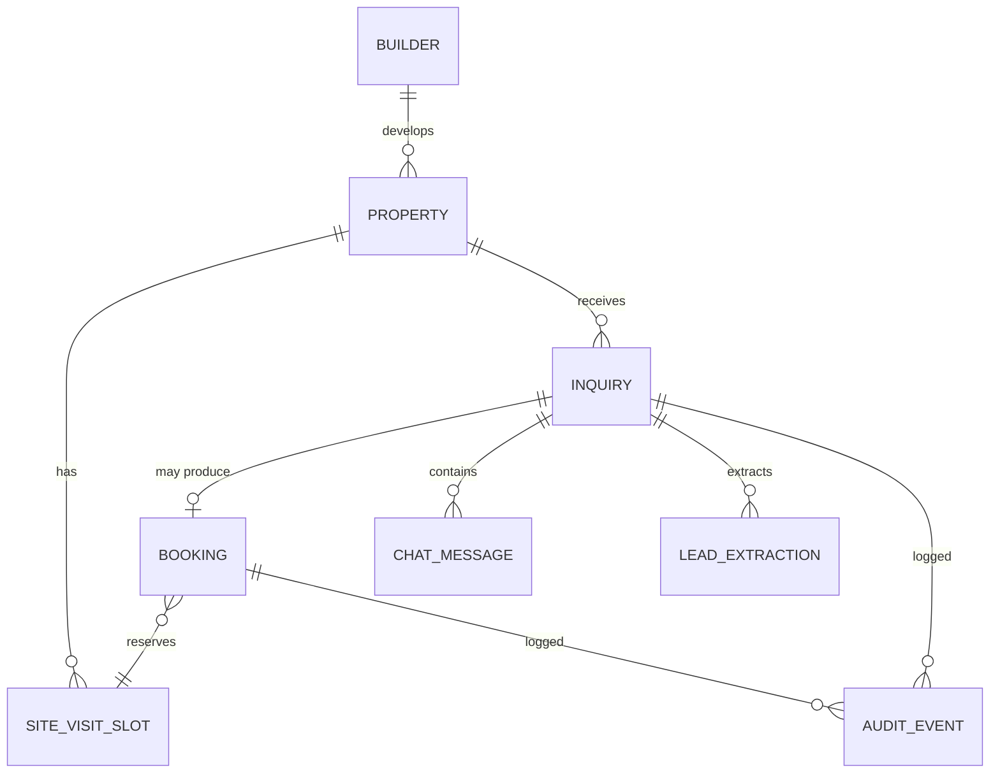
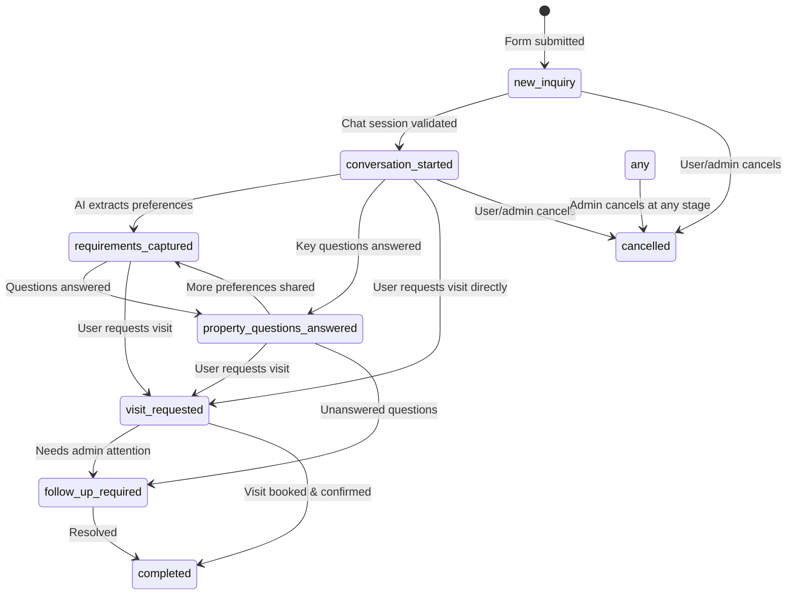
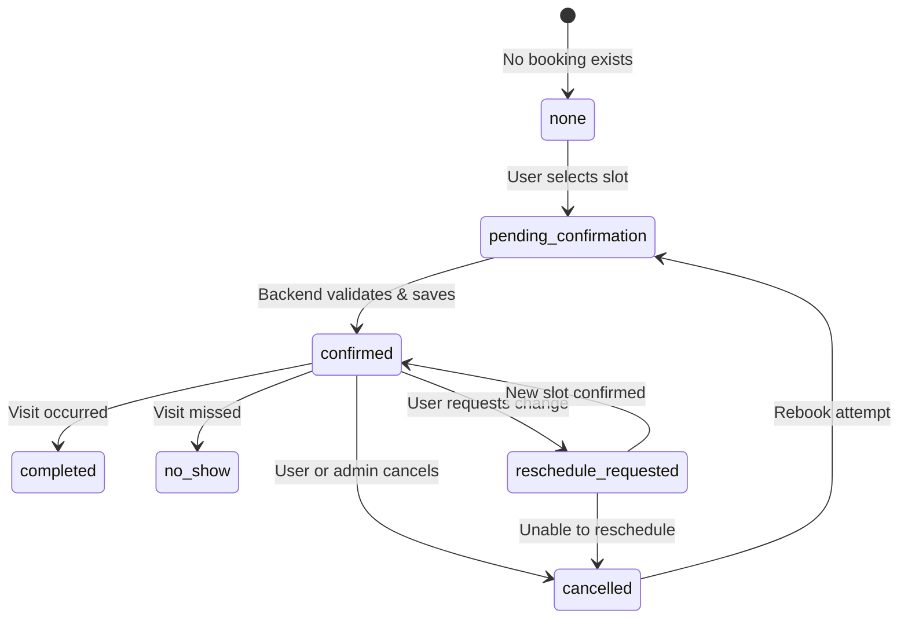

# IQOL — Data Dictionary

> **Phase 1 deliverable** — Domain model and entity reference
> Created: 2026-10-20 · References: [PRODUCT_SPEC.md](file:///c:/Users/run40/Downloads/IQOL/docs/PRODUCT_SPEC.md), [PROJECT_PLAN.md](file:///c:/Users/run40/Downloads/IQOL/docs/PROJECT_PLAN.md)

---

## 1. Entity Relationship Overview



### Cardinality rules

- One builder develops one or more properties.
- One property belongs to exactly one builder.
- One property receives zero or more inquiries.
- One inquiry is about exactly one property.
- One lead (identified by email) may have multiple inquiries (for different properties).
- One inquiry may produce zero or one booking.
- One inquiry contains zero or more chat messages.
- One booking reserves exactly one site-visit slot.
- One site-visit slot belongs to exactly one property.
- One site-visit slot may be reserved by multiple bookings (up to capacity).

---

## 2. Entity Definitions

### 2.1 Builder

Represents a fictional real-estate developer in Bengaluru.

| Field | Type | Required | Description |
|---|---|---|---|
| `id` | UUID | ✅ PK | Unique builder identifier |
| `name` | text | ✅ | Display name (e.g., "Aster Habitat Demo") |
| `slug` | text | ✅ UNIQUE | URL-safe identifier |
| `tagline` | text | ✅ | Short marketing line |
| `description` | text | ✅ | Builder overview paragraph |
| `logo_url` | text | ❌ | Path to builder logo image |
| `established_year` | integer | ❌ | Fictional establishment year |
| `office_label` | text | ❌ | Synthetic office location label |
| `website_placeholder` | text | ❌ | Non-functional demo URL |
| `is_synthetic` | boolean | ✅ | Always `true` for demo data |
| `created_at` | timestamptz | ✅ | Record creation (UTC) |
| `updated_at` | timestamptz | ✅ | Last modification (UTC) |

**Used by:** Property ad (builder badge), chat page (Section D), admin dashboard (builder column).

---

### 2.2 Property

Represents a fictional residential project in Bengaluru.

| Field | Type | Required | Description |
|---|---|---|---|
| `id` | UUID | ✅ PK | Unique property identifier |
| `builder_id` | UUID | ✅ FK → Builder | Associated builder |
| `name` | text | ✅ | Display name (e.g., "Project Aster (DEMO)") |
| `slug` | text | ✅ UNIQUE | URL path segment for `/ad/[slug]` |
| `headline` | text | ✅ | Marketing tagline |
| `description` | text | ✅ | Multi-paragraph property description |
| `hero_image_url` | text | ❌ | Path to hero image |
| `gallery_urls` | text[] | ❌ | Additional image paths |
| `location` | jsonb | ✅ | `{ locality, city, district, state, connectivity[] }` |
| `configurations` | jsonb | ✅ | Array of `{ type, area_sqft_min, area_sqft_max, price_min_inr, price_max_inr }` |
| `price_range_label` | text | ✅ | Human-readable price range (e.g., "₹75 lakh–₹1.15 crore") |
| `area_range_label` | text | ✅ | Human-readable area range (e.g., "1,100–1,650 sq. ft.") |
| `amenities` | text[] | ✅ | Approved amenity names |
| `possession_status` | text | ❌ | e.g., "Expected Q4 2027" or null if unknown |
| `rera_disclaimer` | text | ✅ | Always: "Demo — Not a real RERA registration" |
| `approved_facts` | jsonb | ✅ | Key-value pairs the AI may state |
| `unknown_facts` | text[] | ✅ | Facts explicitly marked as unavailable |
| `faqs` | jsonb | ✅ | Array of `{ question, answer }` objects |
| `visit_instructions` | text | ❌ | How to reach the demo visit location |
| `is_synthetic` | boolean | ✅ | Always `true` |
| `created_at` | timestamptz | ✅ | Record creation (UTC) |
| `updated_at` | timestamptz | ✅ | Last modification (UTC) |

**Used by:** Ad page (all sections), chat page (Sections A, C), AI tool responses, admin dashboard (property column), booking validation.

#### `configurations` JSON structure

```typescript
interface PropertyConfiguration {
  type: string;          // "2 BHK" | "3 BHK"
  area_sqft_min: number; // e.g., 1100
  area_sqft_max: number; // e.g., 1250
  price_min_inr: number; // e.g., 7500000 (stored as paise-free integer)
  price_max_inr: number; // e.g., 9000000
}
```

#### `location` JSON structure

```typescript
interface PropertyLocation {
  locality: string;     // "Whitefield"
  city: string;         // "Bengaluru"
  district: string;     // "Bengaluru Urban"
  state: string;        // "Karnataka"
  connectivity: string[]; // Approved nearby landmarks/routes
}
```

---

### 2.3 SiteVisitSlot

Represents an available time window for property site visits.

| Field | Type | Required | Description |
|---|---|---|---|
| `id` | UUID | ✅ PK | Unique slot identifier |
| `property_id` | UUID | ✅ FK → Property | Which property this slot is for |
| `date` | date | ✅ | Visit date (Asia/Kolkata semantics) |
| `start_time` | time | ✅ | Start time (Asia/Kolkata semantics) |
| `end_time` | time | ✅ | End time (Asia/Kolkata semantics) |
| `max_capacity` | integer | ✅ | Maximum concurrent bookings |
| `booked_count` | integer | ✅ | Current booking count (default 0) |
| `is_available` | boolean | ✅ | Computed: `booked_count < max_capacity AND date >= today` |
| `created_at` | timestamptz | ✅ | Record creation (UTC) |

**Slot generation rules:** Slots should be generated dynamically for future dates using property-specific configuration (e.g., "weekdays 10:00–12:00 and 14:00–16:00, Saturdays 10:00–13:00, capacity 5"). Hardcoded past dates must not be used.

**Used by:** Booking flow (slot picker), AI tool (`check_available_slots`), admin dashboard (booking details).

---

### 2.4 Inquiry

Represents one lead's interest in one specific property.

| Field | Type | Required | Description |
|---|---|---|---|
| `id` | UUID | ✅ PK | Unique inquiry identifier |
| `property_id` | UUID | ✅ FK → Property | The property being enquired about |
| `user_name` | text | ✅ | Lead's full name |
| `user_email` | text | ✅ | Lead's email address |
| `user_phone` | text | ❌ | Lead's contact number (optional, synthetic placeholder) |
| `user_message` | text | ❌ | Optional inquiry message |
| `preferred_language` | text | ❌ | Detected or selected language code |
| `contact_consent` | boolean | ✅ | Must be `true` |
| `inquiry_status` | text | ✅ | See §3.1 |
| `email_status` | text | ✅ | See §3.2 |
| `email_sent_at` | timestamptz | ❌ | When email was accepted by sending service |
| `email_failure_reason` | text | ❌ | Error message if email failed |
| `token_hash` | text | ✅ UNIQUE | SHA-256 hash of the chat token |
| `token_expires_at` | timestamptz | ✅ | Token expiry timestamp (UTC) |
| `token_revoked` | boolean | ✅ | Default `false`; admin can set `true` |
| `chat_session_status` | text | ✅ | See §3.3 |
| `chat_started_at` | timestamptz | ❌ | When chat session was first validated |
| `source_url` | text | ❌ | The `/ad/[slug]` URL where inquiry originated |
| `admin_notes` | text | ❌ | Free-text admin notes |
| `created_at` | timestamptz | ✅ | Record creation (UTC) |
| `updated_at` | timestamptz | ✅ | Last modification (UTC) |

**Key constraint:** One lead (email) + one property = one inquiry. If the same lead enquires again about the same property, a new inquiry is created (not merged), but duplicates within a short window should be prevented.

**Used by:** All routes. Central entity joining lead ↔ property ↔ builder ↔ booking.

---

### 2.5 Booking

Represents a confirmed or pending site-visit reservation.

| Field | Type | Required | Description |
|---|---|---|---|
| `id` | UUID | ✅ PK | Unique booking identifier |
| `inquiry_id` | UUID | ✅ FK → Inquiry, UNIQUE | One booking per inquiry |
| `slot_id` | UUID | ✅ FK → SiteVisitSlot | Reserved slot |
| `visitor_name` | text | ✅ | Name for the visit |
| `visitor_email` | text | ✅ | Email for the visit |
| `visitor_phone` | text | ✅ | Contact number for coordination |
| `visitor_count` | integer | ✅ | Number of visitors (1–10) |
| `visit_notes` | text | ❌ | Optional notes |
| `booking_status` | text | ✅ | See §3.4 |
| `confirmation_code` | text | ✅ UNIQUE | 8-character alphanumeric code |
| `created_at` | timestamptz | ✅ | Record creation (UTC) |
| `updated_at` | timestamptz | ✅ | Last modification (UTC) |

**Constraint:** `inquiry_id` is UNIQUE — one booking per inquiry. If a booking is cancelled and rebooked, the existing booking record is updated (status transition), not duplicated.

**Used by:** Chat page (Section E), booking confirmation, admin dashboard (booking status column, detail panel).

---

### 2.6 ChatMessage

Represents one message in a conversation.

| Field | Type | Required | Description |
|---|---|---|---|
| `id` | UUID | ✅ PK | Unique message identifier |
| `inquiry_id` | UUID | ✅ FK → Inquiry | Associated inquiry/session |
| `role` | text | ✅ | `user` or `assistant` |
| `content` | text | ✅ | Message text content |
| `language` | text | ❌ | Detected language code |
| `message_type` | text | ✅ | `text`, `voice_transcript`, `tool_result`, `system` |
| `metadata` | jsonb | ❌ | Tool call details, extracted data, etc. |
| `created_at` | timestamptz | ✅ | Message timestamp (UTC) |

**Used by:** Chat page (transcript), admin dashboard (conversation summary), lead extraction.

---

### 2.7 LeadExtraction

Represents structured data extracted from the conversation.

| Field | Type | Required | Description |
|---|---|---|---|
| `id` | UUID | ✅ PK | Unique extraction identifier |
| `inquiry_id` | UUID | ✅ FK → Inquiry | Associated inquiry |
| `budget_min_inr` | integer | ❌ | Extracted minimum budget |
| `budget_max_inr` | integer | ❌ | Extracted maximum budget |
| `preferred_config` | text | ❌ | e.g., "3 BHK" |
| `preferred_floor` | text | ❌ | e.g., "High floor" |
| `move_in_timeline` | text | ❌ | e.g., "Within 6 months" |
| `visit_preference` | text | ❌ | e.g., "Weekends only" |
| `additional_requirements` | text[] | ❌ | Free-text extracted needs |
| `unanswered_questions` | text[] | ❌ | Questions the AI could not answer |
| `updated_at` | timestamptz | ✅ | Last extraction update (UTC) |

**Treated as untrusted:** Extracted values are suggestions from the AI, not validated user input. They support the admin's follow-up workflow.

**Used by:** Admin dashboard (detail panel — extracted requirements, unanswered questions).

---

### 2.8 AuditEvent

Represents a trackable action for compliance and debugging.

| Field | Type | Required | Description |
|---|---|---|---|
| `id` | UUID | ✅ PK | Unique event identifier |
| `entity_type` | text | ✅ | `inquiry`, `booking`, `admin_action` |
| `entity_id` | UUID | ✅ | ID of the affected entity |
| `action` | text | ✅ | e.g., `inquiry_created`, `email_sent`, `booking_confirmed` |
| `actor` | text | ✅ | `system`, `user`, `admin`, `ai` |
| `details` | jsonb | ❌ | Additional context |
| `created_at` | timestamptz | ✅ | Event timestamp (UTC) |

**Used by:** Admin dashboard (timeline view), debugging.

### Auditable actions

| Action | Entity | Actor | Trigger |
|---|---|---|---|
| `inquiry_created` | inquiry | system | Form submission |
| `email_sent` | inquiry | system | Email accepted |
| `email_failed` | inquiry | system | Email send error |
| `email_retried` | inquiry | admin | Admin retry |
| `chat_session_started` | inquiry | user | Token validated |
| `chat_session_expired` | inquiry | system | Token past expiry |
| `chat_token_revoked` | inquiry | admin | Admin action |
| `inquiry_status_changed` | inquiry | system/admin | Status transition |
| `booking_created` | booking | user | Booking confirmed |
| `booking_cancelled` | booking | user/admin | Cancellation |
| `booking_status_changed` | booking | system/admin | Status transition |
| `admin_note_added` | inquiry | admin | Admin adds note |
| `lead_extraction_updated` | inquiry | ai | AI extracts data |
| `follow_up_flagged` | inquiry | admin | Admin flags for follow-up |

---

## 3. Status Models (Separate Fields)

> **Critical design decision:** Inquiry status, email status, chat session status and booking status are **separate, independent fields** on their respective entities. They must NOT be merged into a single status.

### 3.1 Inquiry Status (`inquiry.inquiry_status`)

Tracks the overall progress of a lead's interest.



| Status | Description | Trigger |
|---|---|---|
| `new_inquiry` | Inquiry created, awaiting conversation | Form submission |
| `conversation_started` | User has opened chat and validated session | Token validation |
| `requirements_captured` | AI has extracted budget/config/timeline | AI extraction |
| `property_questions_answered` | Key property questions answered | AI interaction |
| `visit_requested` | User has asked about a site visit | User request |
| `follow_up_required` | Admin action needed (unanswered Qs, issues) | System/admin flag |
| `completed` | Inquiry fully addressed | Visit booked or admin resolution |
| `cancelled` | Inquiry cancelled | User or admin action |

**Rules:**
- An email failure does NOT change inquiry status.
- Token expiry does NOT change inquiry status.
- Status can move forward or to `cancelled`/`follow_up_required` from any state.
- Status changes are logged in `AuditEvent`.

---

### 3.2 Email Delivery Status (`inquiry.email_status`)

Tracks whether the invitation email was successfully sent.

| Status | Description | Trigger |
|---|---|---|
| `pending` | Email queued, not yet attempted | Inquiry creation |
| `sent` | Sending service accepted the request | Apps Script returns success |
| `failed` | Sending service returned an error | Apps Script returns error |

**Rules:**
- `sent` means the send API accepted the request. It does NOT confirm recipient delivery or read.
- `failed` records the failure reason in `email_failure_reason`.
- Admin can retry, which resets to `pending` then `sent`/`failed`.
- Email status is completely independent from inquiry status.
- A `failed` email does not cancel the inquiry.

---

### 3.3 Chat Session Status (`inquiry.chat_session_status`)

Tracks the validity of the private chat link.

| Status | Description | Trigger |
|---|---|---|
| `active` | Token valid, session available | Inquiry creation |
| `expired` | Token past expiry timestamp | Time-based (checked on validation) |
| `revoked` | Admin revoked the token | Admin action |

**Rules:**
- Computed on validation: if `token_expires_at < now()`, status is `expired`.
- `revoked` is set explicitly by admin and is permanent for that token.
- An expired or revoked session does NOT delete the inquiry or lead data.
- A new token can be issued (admin action), which resets to `active` with a new expiry.

---

### 3.4 Booking Status (`booking.booking_status`)

Tracks the site-visit booking lifecycle.



| Status | Description | Trigger |
|---|---|---|
| `none` | No booking record exists | Default state (nullable relationship) |
| `pending_confirmation` | User selected slot, awaiting backend confirmation | Slot selection submitted |
| `confirmed` | Backend validated and saved booking | Successful transaction |
| `completed` | Visit occurred | Admin marks complete |
| `cancelled` | Booking cancelled | User or admin action |
| `no_show` | User did not attend | Admin marks no-show |
| `reschedule_requested` | User wants a different slot | User request |

**Rules:**
- `none` means no `Booking` record exists for the inquiry. Do not create a placeholder record.
- `pending_confirmation` is a transient client-side state. The backend either confirms or rejects.
- Only `confirmed` means the booking is real. The UI must not show "confirmed" until the backend responds.
- Cancelled bookings can be rebooked (status transitions back through the flow).
- All status changes are logged in `AuditEvent`.

---

## 4. Data Flow by Feature

### 4.1 Property advertisement page

**Reads:** Property (all fields), Builder (name, tagline, logo_url)

**Writes:** None (read-only page)

### 4.2 Inquiry form submission

**Reads:** Property (id, name — for validation)

**Writes:** Inquiry (create), AuditEvent (inquiry_created)

**Side effect:** Email send attempt → updates email_status, email_sent_at

### 4.3 Private chat — session validation

**Reads:** Inquiry (token_hash, token_expires_at, token_revoked, property_id), Property (all fields), Builder (all fields)

**Writes:** Inquiry (chat_session_status, chat_started_at, inquiry_status → conversation_started), AuditEvent

### 4.4 Private chat — AI conversation

**Reads:** Property (approved_facts, faqs, configurations), SiteVisitSlot (availability)

**Writes:** ChatMessage (create), LeadExtraction (upsert), Inquiry (inquiry_status updates), AuditEvent

### 4.5 Booking flow

**Reads:** SiteVisitSlot (available future slots for property), Inquiry (validation)

**Writes:** Booking (create), SiteVisitSlot (increment booked_count), Inquiry (inquiry_status → completed), AuditEvent

### 4.6 Admin dashboard

**Reads:** Inquiry (joined with Property, Builder, Booking, LeadExtraction, AuditEvent)

**Writes:** Inquiry (admin_notes, inquiry_status, token_revoked), Booking (booking_status), AuditEvent

---

## 5. Currency Formatting Contract

All INR values in the database are stored as integers representing whole rupees (no paise for property prices).

A central `formatINR(amount: number): string` utility provides:
- Indian digit grouping: `₹1,15,00,000`
- Lakh/crore labels where appropriate: `₹1.15 Cr` or `₹75 L`

This utility is used in:
- Property cards and detail views
- AI conversation responses
- Booking confirmation
- Admin dashboard
- Seed data display

Never mix sq. ft. with sq. m. in the same context. Always label units explicitly.

---

## 6. Timezone Contract

- **Storage:** All `timestamptz` columns stored in UTC.
- **Display:** All user-facing dates and times rendered in IST (Asia/Kolkata, UTC+05:30).
- **Date format:** `20 Oct 2026` (day-month-year).
- **Time format:** `10:30 AM` (12-hour with AM/PM) — consistently across the application.
- **Site-visit slots:** `date` and `start_time`/`end_time` fields represent Asia/Kolkata local semantics. The slot "25 Nov 2026, 10:00 AM" means 10:00 AM IST regardless of the server's timezone.
- **Conversion rule:** When displaying a `timestamptz`, always convert to `Asia/Kolkata` before rendering.

---

## 7. Row-Level Security Summary

| Table | Anon read | Anon write | Service role | Auth (admin) |
|---|---|---|---|---|
| `builder` | ✅ | ❌ | ✅ | ✅ |
| `property` | ✅ | ❌ | ✅ | ✅ |
| `site_visit_slot` | ✅ (future only) | ❌ | ✅ | ✅ |
| `inquiry` | ❌ | ❌ | ✅ | ✅ |
| `booking` | ❌ | ❌ | ✅ | ✅ |
| `chat_message` | ❌ | ❌ | ✅ | ✅ |
| `lead_extraction` | ❌ | ❌ | ✅ | ✅ |
| `audit_event` | ❌ | ❌ | ✅ | ✅ (read only) |

All mutations on sensitive tables go through Next.js API routes using the Supabase service role key (server-side only).
