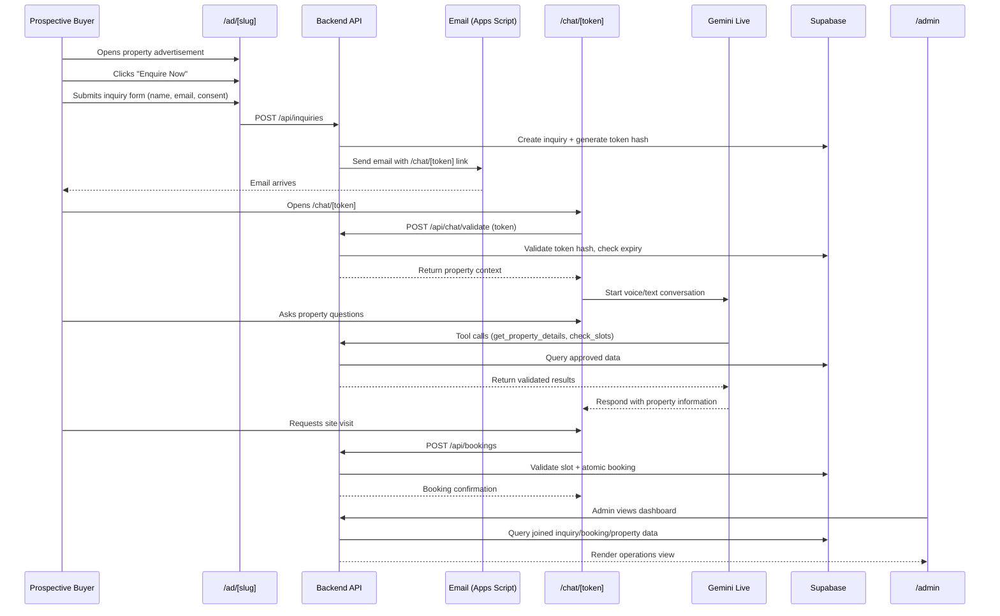

# IQOL — Product Specification

> **Phase 1 deliverable** — Authoritative product contract
> Created: 2026-10-20 · References: [PROJECT_PLAN.md](file:///c:/Users/run40/Downloads/IQOL/docs/PROJECT_PLAN.md)

---

## 1. Product Overview

IQOL is a multilingual real-estate lead-conversion demonstration website set exclusively in **Bengaluru, Karnataka, India**. It demonstrates a complete workflow: property advertisement → inquiry form → email invitation → private AI-powered voice/text conversation → site-visit booking → administrative tracking.

### Purpose

Demonstrate that a property-specific AI assistant can qualify leads, answer property questions in six languages, and convert interest into confirmed site-visit bookings — all tracked through an operations dashboard.

### Context constraints

- **Geography:** Bengaluru only. All properties, builders, addresses, localities and visit locations are Bengaluru-specific.
- **Currency:** INR (₹). Prices expressed in lakh/crore with Indian digit grouping (e.g., ₹1,15,00,000).
- **Measurements:** Square feet (sq. ft.). Configurations use BHK notation.
- **Timezone:** Asia/Kolkata (IST). All display dates/times in IST.
- **Language:** Indian English for UI text. Six conversation languages: English, Hindi, Kannada, Telugu, Tamil, Malayalam.
- **Data:** All records are synthetic/fictional. No real listings, builders, or personal data.
- **Budget:** ₹0 direct service expenditure.

---

## 2. User Journey

---

## 3. Route Specifications

### 3.1 `/ad/[slug]` — Public Property Advertisement

**Purpose:** Present a synthetic property listing and capture buyer interest.

**Rendering:** Server-side rendered. Property data from canonical demo inventory.

**URL parameter:** `slug` — one of `project-aster`, `project-nila`, `project-cedar`.

**Page sections (top to bottom):**

1. **Hero section**
   - Property name with (DEMO) label
   - Location label (locality, Bengaluru)
   - Hero image (generated, Bengaluru-appropriate)
   - Headline/tagline

2. **Key highlights**
   - Configurations (e.g., 2 BHK, 3 BHK)
   - Price range (₹ lakh/crore format)
   - Area range (sq. ft.)
   - Possession status if available

3. **Amenities grid**
   - Approved amenity list with icons
   - No unapproved amenities

4. **Location context**
   - Locality label and Bengaluru district
   - Connectivity highlights (approved synthetic data only)
   - Map placeholder (not a live embed)

5. **Builder badge**
   - Builder name
   - Brief builder tagline
   - Link to builder details section

6. **Property FAQ accordion**
   - 12–20 property-specific Q&A pairs
   - Answers from approved canonical data only
   - Unknown items marked clearly

7. **Inquiry form (Enquire Now)**
   - Fields: Full name (required), Email (required), Contact number (optional), Message (optional), Contact consent checkbox (required)
   - Submit → `POST /api/inquiries`
   - Validation: email format, name non-empty, consent checked
   - Loading state during submission
   - Success state: "Check your email for a private conversation link"
   - Error state: clear message, retry option
   - Duplicate protection: server-side

8. **Footer**
   - Synthetic data disclaimer
   - Legal notice placeholder

**States:**
- **Loading:** Skeleton/shimmer for property data
- **Not found:** Invalid slug → friendly 404 with navigation
- **Error:** Server error → retry message
- **Success (form):** Confirmation with email instruction

**Inputs:** `slug` (URL path parameter)

**Outputs:** Rendered property page; inquiry creation on form submit

**Errors:**
| Condition | Response |
|---|---|
| Invalid slug | 404 page with "Property not found" |
| Server error | 500 page with retry option |
| Form validation failure | Inline field errors |
| Duplicate email for same property | Accept gracefully, create new inquiry |
| Email send failure | Inquiry preserved; admin notified; user told to contact support |

---

### 3.2 `/chat/[token]` — Private Property-Scoped Conversation

**Purpose:** Provide a secure, property-specific AI conversation without requiring account creation.

**Rendering:** Client-side interactive. Token validated server-side before rendering.

**URL parameter:** `token` — raw cryptographic token from email link.

**Critical rule:** HTTP GET must NOT consume, invalidate or revoke the token. Email security scanners may prefetch URLs.

**Page load sequence:**
1. Render loading state (no property data exposed).
2. `POST /api/chat/validate` with token in request body.
3. If valid: render conversation page with property context.
4. If invalid/expired/revoked: render appropriate error state.

**Information hierarchy (Sections A–E, mandatory order):**

#### Section A: Property-linked header
- Project name prominently displayed
- Locality label (e.g., "Whitefield, Bengaluru")
- Builder name
- Visual confirmation this is the correct property
- Language selector dropdown (6 languages)

#### Section B: Live conversation area
- **Microphone control:** Start/stop speaking button
- **Voice states:** Idle, Listening, Thinking, Speaking, Reconnecting, Error
- **Waveform visualisation:** Audio level indicator during listening/speaking
- **Conversation transcript:** Scrollable message list showing user and assistant messages
- **Text input:** Always-available text field with send button
- **Mute/stop control:** Interrupt assistant speech
- **Language indicator:** Current conversation language
- **Voice fallback notice:** Shown when mic unavailable, explaining text-only mode

#### Section C: Your Property (directly below conversation)
- Project name and locality
- Available configurations with pricing
- Area range
- Approved amenities list
- Possession information (if defined)
- Key approved facts
- NOT hidden behind a tab or modal by default

#### Section D: Builder Details (directly below property)
- Builder name
- Builder overview/description
- Associated project
- Synthetic office label (if supplied)
- "DEMO — Synthetic information" label

#### Section E: Site-visit entry point
- "Schedule a Visit" button/card
- Opens slot picker inline or in a sheet
- Available slots for this property only
- Review step before confirmation
- Booking confirmation display
- Empty state if no slots available

**Voice/text behaviour:**
- Mic permission request on first tap (not on page load)
- If mic denied: hide voice controls, show text-only notice, text input remains
- If voice connection drops: auto-reconnect with exponential backoff (max 3 attempts), then fall back to text
- If session limit reached: notify user, offer text continuation
- Typing indicator / "thinking" state during AI processing
- Messages persist in scrollable transcript

**States:**
| State | Display |
|---|---|
| Loading | Skeleton with "Verifying your link…" |
| Valid token | Full conversation page |
| Expired token | "This link has expired. Contact support for a new one." |
| Revoked token | "This link is no longer active." |
| Invalid token | "Invalid link. Please check your email." |
| Voice connected | Mic button active, waveform visible |
| Voice disconnected | Reconnecting indicator |
| Mic denied | Text-only notice, voice controls hidden |
| Booking confirmed | Confirmation card with details |

**Inputs:** `token` (URL path parameter), user voice/text, booking selections

**Outputs:** AI responses, property data display, booking confirmations

**Errors:**
| Condition | Response |
|---|---|
| Invalid token | Error page, no data exposed |
| Expired token | Friendly expiry message |
| Voice API failure | Automatic text fallback |
| Booking slot unavailable | "Slot no longer available, please choose another" |
| Network error | Reconnection with user notice |

---

### 3.3 `/admin/login` — Administrator Authentication

**Purpose:** Authenticate the operations administrator.

**Rendering:** Client-side form.

**Fields:** Email (required), Password (required)

**Authentication:** Supabase Auth email/password.

**On success:** Redirect to `/admin`.

**On failure:** Inline error message (generic: "Invalid email or password").

**Security:**
- No self-registration. Single seeded admin account.
- Rate limiting on login attempts.
- No password hints or user enumeration.
- Session managed via Supabase Auth cookies.

**States:**
| State | Display |
|---|---|
| Default | Login form |
| Submitting | Loading indicator on button |
| Error | "Invalid email or password" |
| Success | Redirect to /admin |
| Already authenticated | Redirect to /admin |

---

### 3.4 `/admin` — Protected Operations Dashboard

**Purpose:** Track inquiry-to-booking relationships. NOT a builder CRM.

**Rendering:** Server-side with client-side interactivity. Protected by middleware auth check.

**Access:** Authenticated administrator only. Unauthenticated → redirect to `/admin/login`.

**Dashboard layout:**

1. **Header bar**
   - IQOL Admin logo/title
   - Logged-in admin indicator
   - Sign out button

2. **Summary cards (top row)**
   - Total inquiries (count)
   - Active conversations (count)
   - Pending bookings (count)
   - Confirmed visits (count)

3. **Inquiry table (main view)**
   - Columns: Lead name, Email, Property, Builder, Inquiry status, Email status, Chat status, Booking status, Created, Last activity
   - Searchable by lead name, email, property name
   - Filterable by: inquiry status, booking status, property, builder
   - Sortable by any column
   - Click row → detail panel

4. **Inquiry detail panel (side sheet or expanded row)**
   - **Lead section:** Name, email, contact number, preferred language
   - **Property section:** Project name, locality, configuration, price range
   - **Builder section:** Builder name, associated project
   - **Inquiry section:** Source ad URL, creation time, current status, status history
   - **Email section:** Delivery status, sent time, failure reason if any
   - **Chat section:** Session status, token expiry, conversation summary, extracted requirements, unanswered questions
   - **Booking section:** Booking status, requested date/time, slot details, visitor count, confirmation code
   - **Timeline:** Chronological audit events (inquiry created, email sent, chat started, booking confirmed, etc.)

5. **Quick actions**
   - Revoke chat token
   - Mark inquiry as follow-up required
   - Add admin note
   - Cancel booking (with reason)

**Joined data model:**
Each row represents one inquiry, joined with:
- Lead (user_name, user_email from inquiry)
- Property (via inquiry.property_id)
- Builder (via property.builder_id)
- Booking (via booking.inquiry_id, nullable)
- Chat session (via inquiry token status)

Multiple inquiries from the same lead are shown as separate rows.

**States:**
| State | Display |
|---|---|
| Loading | Table skeleton |
| Empty | "No inquiries yet" with explanation |
| Data loaded | Populated table |
| Detail open | Side panel with full inquiry context |
| Error | Retry message |

---

## 4. Six-Language Conversation Policy

### Supported languages

| Language | Code | Script | Voice support |
|---|---|---|---|
| English | `en` | Latin | Expected: full |
| Hindi | `hi` | Devanagari | Expected: full |
| Kannada | `kn` | Kannada | To be verified |
| Telugu | `te` | Telugu | To be verified |
| Tamil | `ta` | Tamil | To be verified |
| Malayalam | `ml` | Malayalam | To be verified |

### Behaviour rules

1. **Default language:** English.
2. **Follow the user:** Detect and switch to the primary language of the user's latest clearly understood utterance.
3. **Context preservation:** Property details, booking state and extracted requirements persist across language switches. Switching language must NOT change the property, builder or inquiry context.
4. **Manual override:** Language dropdown in chat header. Selection immediately changes the AI's response language.
5. **Ambiguity handling:** If the user's language is unclear, ask for clarification in the last reliably detected language.
6. **Code-switching:** Allow mixed-language input where Gemini supports it. Do not guarantee perfect accuracy. Document this as a known limitation.
7. **Text fallback:** The same conversation is always accessible via text input when voice is unavailable.

### Fallback response (all 6 languages)

When a requested fact is unavailable:

| Language | Fallback |
|---|---|
| English | "I don't have verified information about that in this demo's property data. I can note your question for follow-up." |
| Hindi | "इस डेमो के प्रॉपर्टी डेटा में इसकी सत्यापित जानकारी मेरे पास नहीं है। मैं आपका सवाल फ़ॉलो-अप के लिए नोट कर सकता/सकती हूँ।" |
| Kannada | "ಈ ಡೆಮೊದ ಆಸ್ತಿ ಮಾಹಿತಿಯಲ್ಲಿ ಅದರ ಬಗ್ಗೆ ಪರಿಶೀಲಿಸಿದ ಮಾಹಿತಿ ನನ್ನ ಬಳಿ ಇಲ್ಲ. ನಿಮ್ಮ ಪ್ರಶ್ನೆಯನ್ನು ಫಾಲೋ-ಅಪ್‌ಗಾಗಿ ನೋಟ್ ಮಾಡಬಹುದು." |
| Telugu | "ఈ డెమో ప్రాపర్టీ డేటాలో దాని గురించి ధృవీకరించిన సమాచారం నా వద్ద లేదు. మీ ప్రశ్నను ఫాలో-అప్ కోసం నోట్ చేయగలను." |
| Tamil | "இந்த டெமோவின் சொத்துத் தரவில் அதைப் பற்றிய சரிபார்க்கப்பட்ட தகவல் என்னிடம் இல்லை. உங்கள் கேள்வியை பின்தொடர்வதற்காக குறிப்பிடலாம்." |
| Malayalam | "ഈ ഡെമോയുടെ പ്രോപ്പർട്ടി ഡാറ്റയിൽ അതിനെക്കുറിച്ച് പരിശോധിച്ച വിവരം എന്റെ പക്കലില്ല. നിങ്ങളുടെ ചോദ്യം ഫോളോ-അപ്പിനായി കുറിക്കാം." |

> **Note:** These translations are prepared for the intended meaning. Actual voice output accuracy must be verified in browser testing during Phase 4. Translation quality for Kannada, Telugu, Tamil and Malayalam is a known verification item.

### Graceful degradation matrix

| Scenario | Voice | Text | Action |
|---|---|---|---|
| Mic permission denied | ❌ Disabled | ✅ Available | Show "Voice unavailable" notice |
| Voice connection drops | ❌ Reconnecting | ✅ Available | Auto-reconnect (3 attempts), then text-only |
| Language voice unsupported | ❌ For that language | ✅ Available | "Voice not available for [language], using text" |
| Session time limit | ❌ Expired | ✅ Available | "Voice session ended, continue via text" |
| High latency | ⚠️ Degraded | ✅ Available | Show "thinking…" indicator |
| Complete API failure | ❌ Unavailable | ⚠️ Limited | Show error, offer to note questions for follow-up |

---

## 5. AI Knowledge and Safety Contract

### Allowed actions

The AI assistant may:
- Answer property questions using only approved canonical data.
- Present property configurations, prices, areas and amenities from the approved fact set.
- Offer to check site-visit slot availability via a backend tool call.
- Extract the user's preferences (budget, configuration, visit date, contact details).
- Record unanswered questions for follow-up.
- Switch conversation language.

### Prohibited actions

The AI assistant must NOT:
- Invent property prices, discounts or offers.
- Fabricate amenities, possession dates or legal approvals.
- Claim investment returns, appreciation rates or rental yields.
- Make commitments on behalf of the builder.
- Confirm a booking without a successful backend transaction.
- Access or display data from a different property than the session's property.
- Accept an arbitrary property ID from user input to switch context.
- Store or repeat sensitive personal information unnecessarily.

### Backend tool allowlist

| Tool | Purpose | Validation |
|---|---|---|
| `get_current_property_details` | Return approved property data | Property scoped to session |
| `get_property_faq` | Return FAQ for session property | Property scoped to session |
| `check_available_slots` | Query future available visit slots | Property scoped; future dates only |
| `save_lead_details` | Store extracted preferences | Validated against inquiry; server-side |
| `create_booking` | Reserve a visit slot | Full server-side validation, atomic |
| `request_follow_up` | Record unanswered question | Linked to inquiry |

Every tool call is intercepted by the Next.js API route, validated against the session's inquiry and property, and executed with the Supabase service role. The AI model does not directly write to the database.

---

## 6. Booking Business Rules

### Prerequisites

A booking requires:
- A valid, non-expired, non-revoked inquiry session
- A slot belonging to the session's property
- A future date/time (in Asia/Kolkata)
- Visitor name (pre-filled from inquiry if available)
- Email address (pre-filled from inquiry)
- Contact number (collected during booking if not already provided)
- Number of visitors (integer, 1–10)
- Optional visit notes
- Explicit user confirmation ("Confirm Visit" action)
- Successful backend transaction

### Slot selection flow

1. User requests a visit (via AI conversation or "Schedule a Visit" button).
2. Frontend fetches available future slots for the session's property.
3. User selects a slot.
4. Frontend displays review step: date, time (IST), property, visitor details.
5. User may edit contact details before confirming.
6. User clicks "Confirm Visit."
7. Backend validates: inquiry validity, property match, slot availability, slot capacity, contact data.
8. Backend atomically decrements slot capacity and creates booking record.
9. On success: return confirmation with booking code.
10. On failure: return specific error (slot taken, capacity full, session expired).

### Invariants

- A slot cannot be booked beyond its capacity.
- Duplicate submissions (same inquiry + same slot) must not create duplicate bookings.
- A booking belongs to exactly one inquiry and one slot.
- The slot must belong to the inquiry's property.
- Past slots are rejected.
- An expired or revoked session cannot create bookings.
- Only a confirmed backend transaction produces "Booking confirmed" state.
- Concurrent booking attempts must be handled (optimistic locking or serialised transaction).

### Date/time handling

- Slots are stored with UTC timestamps in the database.
- All display to the user is in IST (Asia/Kolkata, UTC+05:30).
- Date format: `20 Oct 2026` (day month year).
- Time format: `10:30 AM IST` or `10:30` in 24-hour format — consistently one or the other.
- Date-only values must not be shifted by timezone conversion.

---

## 7. Email Invitation Contract

### Email content

- Subject: "Your private conversation link — [Property Name]"
- Body: Property name, locality, personalised greeting, secure link, expiry notice, synthetic-data disclaimer
- Link format: `{BASE_URL}/chat/{raw_token}`
- No sensitive data in the email body beyond the link and property name

### Token lifecycle

1. **Generation:** 32-byte cryptographically random token via `crypto.randomBytes(32)`.
2. **Storage:** SHA-256 hash of the token stored in `inquiry.token_hash`. Raw token never stored.
3. **Delivery:** Raw token embedded in email link.
4. **Validation:** On `/chat/[token]` access, hash the presented token and compare to stored hash.
5. **Expiry:** Configurable, default 7 days from creation.
6. **Revocation:** Admin can set `token_revoked = true`. Revocation is permanent for that token.

### Non-destructive GET requirement

- HTTP GET to `/chat/[token]` renders the page but does NOT consume, invalidate or revoke the token.
- Validation occurs via a separate `POST /api/chat/validate` call initiated by client-side JavaScript after page load.
- This protects against email security scanners that prefetch links.
- Multiple GETs to the same URL are safe and idempotent.

### Failure handling

- Email send failure: Inquiry is preserved. `email_status` set to `failed`. Admin can see failed emails in dashboard. Retry mechanism available.
- Email retry: Does not create a duplicate inquiry. Updates the existing inquiry's email status and generates a new token if needed.
- Expired link: Friendly message. Inquiry and lead data preserved. Admin can issue a new link.
- Revoked link: Clear message. No data exposed.

---

## 8. Privacy and Data Notices

### User-facing notices

1. **Inquiry form:** "By submitting, you consent to [Demo Company] storing your name and email to facilitate a property conversation. This is a demonstration — all property data is synthetic."
2. **Chat page:** "This conversation may be recorded as text for demonstration purposes. Voice recordings are not stored. Contact your administrator to request data removal."
3. **Booking confirmation:** "Your visit details are stored for coordination purposes. This is a demonstration booking."

### Data minimisation

- Collect only: name, email, optional contact number, optional message, consent.
- Do not collect: government ID, financial details, precise location.
- Voice audio: Not stored. Only text transcripts retained.
- Transcripts: Stored in `chat_message` table, accessible to admin only.
- Deletion: Admin can delete inquiry records (Phase 5+ consideration).

---

## 9. UI State Matrix

### Cross-cutting states (all pages)

| State | Behaviour |
|---|---|
| Loading | Skeleton/shimmer, no content flash |
| Error (recoverable) | Error message with retry action |
| Error (fatal) | Error page with support contact |
| Empty | Contextual empty state message |
| Success | Confirmation with next-step guidance |
| Offline | "Connection lost" banner |

### Responsive breakpoints

| Breakpoint | Target |
|---|---|
| < 640px | Mobile (single column) |
| 640–1024px | Tablet (adaptive columns) |
| > 1024px | Desktop (full layout) |

### Accessibility requirements

- Keyboard navigation for all interactive elements
- Visible focus indicators
- ARIA labels for controls without visible text
- Contrast ratio ≥ 4.5:1 for text
- Reduced motion support (`prefers-reduced-motion`)
- Screen reader announcements for state changes
- Form error association with fields
- Skip-to-content link
