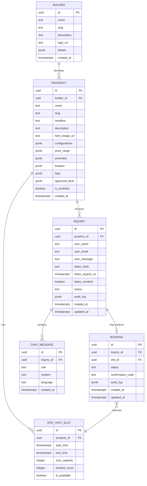

# IQOL — Project Plan

> **Phase 0 deliverable** — Planning & architecture lock
> Created: 2026-10-20 · Status: **APPROVED FOR PHASE 1**

---

## 1. Product Summary

IQOL is a multilingual real-estate lead-conversion demonstration website. A prospective buyer discovers a synthetic property ad, submits an inquiry, receives a secure email link, then engages in a private AI-powered voice/text conversation scoped to that property and its builder. The conversation assists with questions and site-visit booking. An authenticated administrator monitors all inquiries, bookings and follow-up actions through a protected dashboard.

### Scope boundaries

| In scope | Out of scope |
|---|---|
| 3 synthetic properties, 2 fictional builders | Real listings, scraping, real PII |
| Email-based inquiry flow | WhatsApp, SMS, phone calls |
| AI voice + text chat (6 languages) | Video calls, screen sharing |
| Site-visit slot selection & booking | Payment processing, e-signatures |
| Admin ops dashboard | Builder CRM, analytics platform |
| Vercel Hobby deployment | Custom domain SSL, CDN tuning |
| ₹0 demonstration budget | Paid tiers of any service |

---

## 2. Workspace Findings

| Item | Finding |
|---|---|
| Directory | `c:\Users\run40\Downloads\IQOL` — **completely empty** |
| Git | Not initialised |
| Node.js | v25.9.0 |
| npm | 11.6.2 |
| Existing code | None |
| Existing dependencies | None |
| Environment files | None |
| Errors | None (nothing to error) |

**Assessment:** Clean slate. We will scaffold a fresh Next.js App Router project in this directory during Phase 2.

---

## 3. Chosen Architecture & Rationale

### Stack

| Layer | Choice | Reason |
|---|---|---|
| Framework | **Next.js 15 App Router, TypeScript** | SSR/RSC, file-based routing, API routes, middleware — single repo |
| Styling | **Tailwind CSS 4 + shadcn/ui** | Rapid, consistent design system; user-specified |
| Icons | **Lucide React** | Tree-shakeable, consistent with shadcn |
| Animation | **Framer Motion** | Restrained transitions only; `prefers-reduced-motion` respected |
| Database | **Supabase PostgreSQL** | Free tier, RLS, real-time subscriptions, managed |
| Auth (admin) | **Supabase Auth** | Built-in, row-level security integration |
| AI Voice | **Gemini Live API** | Multilingual, streaming, free-tier quota to be verified |
| Email | **Google Apps Script MailApp** | Zero-cost transactional email, quota ~100/day |
| Deployment | **Vercel Hobby** | Free, zero-config Next.js hosting |
| Package manager | **npm** | Already installed, no extra tooling |

### Architectural principles

1. **Single repository, single deployment.** No microservices.
2. **Server Components by default.** Client Components only for interactivity.
3. **API Routes for mutations.** All sensitive operations server-side.
4. **One source of truth.** Shared TypeScript types for domain objects.
5. **No paid services.** Every integration verified against free-tier limits.

---

## 4. Route & Component Map

### Routes

```
/                           → Redirect to /ad/sunrise-towers (or landing index)
/ad/[slug]                  → Public property landing page (SSR)
/chat/[token]               → Private property-scoped conversation (Client)
/admin/login                → Administrator sign-in (Client)
/admin                      → Protected ops dashboard (SSR + Client)
/api/inquiries              → POST: create inquiry, send email
/api/inquiries/[id]         → PATCH: update inquiry status
/api/chat/validate          → POST: validate token, return property context
/api/chat/gemini            → POST/WS: proxy Gemini requests (server-side keys)
/api/bookings               → POST: create booking
/api/bookings/[id]          → PATCH: update booking
/api/admin/auth             → Supabase Auth callback
```

### Key components

```
Layout & Shell
├── RootLayout              — fonts, metadata, theme provider
├── Navbar                  — minimal site header
└── Footer                  — legal notice, synthetic-data disclaimer

Property Ad (/ad/[slug])
├── PropertyHero            — hero image, headline, price
├── PropertyHighlights      — config, area, key facts
├── PropertyAmenities       — amenity grid
├── PropertyLocation        — location label, map placeholder
├── PropertyFAQ             — accordion
├── BuilderBadge            — builder name & logo link
├── InquiryForm             — name, email, message → POST /api/inquiries
└── InquiryConfirmation     — success state with email notice

Chat (/chat/[token])
├── ChatHeader              — property name, builder, language selector
├── VoiceArea               — mic button, waveform, status, transcript
├── TextInput               — text alternative input
├── MessageList             — conversation transcript
├── PropertyDetailCard      — inline property summary
├── BuilderDetailCard       — inline builder summary
├── BookingWidget           — slot picker, confirm, status
└── ChatDisclaimer          — data storage notice

Admin
├── LoginForm               — email/password Supabase Auth
├── DashboardLayout         — sidebar nav, header
├── InquiryTable            — searchable, filterable, sortable
├── InquiryDetail           — user ↔ property ↔ builder ↔ booking panel
├── BookingTable            — booking list with status filters
├── StatusBadge             — colour-coded inquiry/booking status
└── AuditLog                — recent audit events list
```

---

## 5. Proposed Repository Structure

```
IQOL/
├── docs/
│   ├── PROJECT_PLAN.md          ← this file
│   ├── PRODUCT_SPEC.md          ← Phase 1 deliverable
│   └── SEED_DATA.md             ← Phase 1 deliverable
├── public/
│   ├── images/
│   │   ├── properties/          ← synthetic property images
│   │   └── builders/            ← synthetic builder logos
│   └── favicon.ico
├── src/
│   ├── app/
│   │   ├── layout.tsx
│   │   ├── page.tsx             ← root redirect
│   │   ├── ad/
│   │   │   └── [slug]/
│   │   │       └── page.tsx
│   │   ├── chat/
│   │   │   └── [token]/
│   │   │       └── page.tsx
│   │   ├── admin/
│   │   │   ├── login/
│   │   │   │   └── page.tsx
│   │   │   ├── layout.tsx       ← auth guard
│   │   │   └── page.tsx
│   │   └── api/
│   │       ├── inquiries/
│   │       │   ├── route.ts
│   │       │   └── [id]/
│   │       │       └── route.ts
│   │       ├── chat/
│   │       │   ├── validate/
│   │       │   │   └── route.ts
│   │       │   └── gemini/
│   │       │       └── route.ts
│   │       ├── bookings/
│   │       │   ├── route.ts
│   │       │   └── [id]/
│   │       │       └── route.ts
│   │       └── admin/
│   │           └── auth/
│   │               └── callback/
│   │                   └── route.ts
│   ├── components/
│   │   ├── ui/                  ← shadcn primitives
│   │   ├── property/            ← PropertyHero, PropertyHighlights, etc.
│   │   ├── chat/                ← VoiceArea, TextInput, MessageList, etc.
│   │   ├── admin/               ← InquiryTable, BookingTable, etc.
│   │   └── shared/              ← Navbar, Footer, StatusBadge, etc.
│   ├── lib/
│   │   ├── supabase/
│   │   │   ├── client.ts        ← browser client
│   │   │   ├── server.ts        ← server client
│   │   │   └── admin.ts         ← service-role client
│   │   ├── gemini/
│   │   │   └── client.ts
│   │   ├── email/
│   │   │   └── send.ts
│   │   ├── tokens.ts            ← token generation, hashing, validation
│   │   ├── validators.ts        ← Zod schemas
│   │   └── constants.ts         ← shared constants
│   ├── types/
│   │   └── index.ts             ← domain types (Property, Builder, Inquiry, Booking, etc.)
│   ├── data/
│   │   └── seed.ts              ← canonical synthetic seed data
│   └── hooks/
│       ├── use-voice.ts         ← Gemini Live voice hook
│       └── use-language.ts      ← language preference hook
├── supabase/
│   ├── migrations/              ← SQL migration files
│   └── seed.sql                 ← seed data SQL
├── scripts/
│   └── seed.ts                  ← seed runner
├── tests/
│   ├── unit/
│   ├── integration/
│   └── e2e/
├── .env.local.example           ← documented env vars, no secrets
├── .gitignore
├── next.config.ts
├── tailwind.config.ts
├── tsconfig.json
├── package.json
└── README.md
```

---

## 6. Data Model (Conceptual)



### Inquiry statuses
`new` → `email_sent` → `link_opened` → `in_conversation` → `booking_requested` → `booking_confirmed` → `completed` | `expired` | `cancelled`

### Booking statuses
`pending` → `confirmed` → `completed` | `cancelled` | `no_show`

---

## 7. Integration Dependencies

| Service | Purpose | Free-tier limit | Verification needed |
|---|---|---|---|
| **Supabase** | PostgreSQL, Auth, RLS | 500 MB DB, 50k auth MAU, 2 projects | Create project, get keys |
| **Gemini Live API** | Voice AI conversation | Verify quota per model; rate limits | Test connection, confirm multilingual support for all 6 languages |
| **Google Apps Script** | Email delivery via MailApp | ~100 emails/day (consumer), ~1500 (Workspace) | Deploy script, test delivery |
| **Vercel** | Hosting & serverless functions | 100 GB bandwidth, 100k function invocations, 10s execution | Deploy, monitor usage |

### Email flow (Google Apps Script)

```
Next.js API Route (POST /api/inquiries)
  → HTTPS POST to Google Apps Script Web App URL
    → MailApp.sendEmail(to, subject, htmlBody)
      → User receives email with /chat/[token] link
```

The Apps Script URL is stored as a server-side environment variable. The script validates a shared secret before sending.

---

## 8. Security Boundaries

### Token lifecycle

1. `POST /api/inquiries` generates a 32-byte cryptographically random token.
2. The raw token is included in the email link: `/chat/{raw_token}`.
3. Only the **SHA-256 hash** of the token is stored in the `inquiry.token_hash` column.
4. Token validation: hash the incoming token, compare against stored hash, check expiry and revocation.
5. Tokens expire after 7 days (configurable). Admin can revoke.

### Row-level security

| Table | Policy |
|---|---|
| `property`, `builder`, `site_visit_slot` | Public read |
| `inquiry` | Service role only (API routes) |
| `booking` | Service role only (API routes) |
| `chat_message` | Service role only (API routes) |

All mutations go through Next.js API routes using the Supabase **service role** key (server-side only). The browser Supabase client is used only for admin auth and public reads.

### AI safety

- Gemini system prompt is scoped to the specific property's `approved_facts`.
- Tool calls (e.g., `checkSlotAvailability`, `createBooking`) are validated by the backend before database writes.
- The model cannot fabricate property details — only approved data is in the prompt.
- Unknown questions receive an explicit "I don't have that information" response.

### Admin authentication

- Supabase Auth email/password.
- Server-side session validation via `getUser()` in API routes and middleware.
- Admin layout uses Next.js middleware to redirect unauthenticated requests.
- A single admin account seeded for demo; no self-registration.

---

## 9. Language Policy

### Behaviour rules

1. **Default:** English.
2. **Follow the user:** Switch to the main language of the latest clearly understood user utterance.
3. **Preserve context:** Property details and booking state persist across language changes.
4. **Manual override:** Language selector in chat header (dropdown with 6 options).
5. **Ambiguity:** If language is unclear, ask for clarification in the last reliable language.
6. **Mixed language:** Allow code-switching where Gemini supports it; do not guarantee perfect accuracy.
7. **Fallback:** Text mode always available when mic access is denied or voice connection fails.

### Graceful degradation

| Scenario | Handling |
|---|---|
| Mic permission denied | Show text input, hide voice controls, display notice |
| Voice connection drops | Auto-reconnect with backoff; fall back to text after 3 failures |
| Unsupported language voice | Text-only for that language with notice |
| Session limit reached | Notify user, offer to continue via text |
| High latency | Show "thinking…" indicator, don't freeze UI |

---

## 10. Implementation Sequence

### Phase 0 — Planning ✅ (this document)

- Workspace inspection
- Architecture lock
- Engineering plan

**Exit gate:** Plan reviewed and approved.

---

### Phase 1 — Product Contract & Synthetic Data

**Scope:** Define the exact product specification, canonical seed data, TypeScript domain types, and acceptance test specifications.

**Deliverables:**
- `docs/PRODUCT_SPEC.md` — detailed product specification
- `docs/SEED_DATA.md` — 3 properties, 2 builders, slots, example inquiries
- Domain type definitions (to be placed in `src/types/` in Phase 2)
- Acceptance test list per route

**Files changed:** `docs/` only (no application code yet)

**Acceptance criteria:**
- Every route has defined inputs, outputs and error states.
- Every seed entity has consistent cross-references.
- Acceptance tests are specific and testable.
- Unknown fields and fallback answers are documented.

**Exit gate:** Spec and data reviewed; no contradictions; all routes covered.

---

### Phase 2 — Project Scaffold & Design System

**Scope:** Initialise Next.js project, install dependencies, configure Tailwind + shadcn, build design tokens, create shared layout and all page shells.

**Deliverables:**
- Working Next.js app with all routes rendering shells
- Design system: colours, typography, spacing, components
- Shared layout (Navbar, Footer)
- Property ad page with static seed data
- Chat page shell (no AI yet)
- Admin login and dashboard shells
- Responsive layouts
- Synthetic property images (generated)

**Files changed:** All `src/`, `public/`, config files

**Acceptance criteria:**
- `npm run dev` starts without errors.
- All routes render correct shells.
- Design matches editorial real-estate aesthetic.
- Mobile responsive.
- Lighthouse accessibility ≥ 90.

**Exit gate:** Visual review of all pages; no TypeScript or lint errors.

---

### Phase 3 — Database, Inquiry Flow, Email & Admin Auth

**Scope:** Supabase setup, migrations, RLS policies, inquiry API, token generation, email integration, admin auth.

**Deliverables:**
- Supabase migration files
- Seed data SQL
- `POST /api/inquiries` — create inquiry + send email
- Token generation and validation
- Google Apps Script email sender
- Admin login with Supabase Auth
- Admin dashboard reading real data

**Files changed:** `supabase/`, `src/lib/`, `src/app/api/`, admin pages

**Acceptance criteria:**
- Inquiry form submits and creates DB record.
- Email arrives with valid `/chat/[token]` link.
- Token validation works (valid, expired, revoked cases).
- Admin login works; unauthenticated requests redirected.
- RLS policies tested.

**Exit gate:** End-to-end inquiry flow tested in browser.

---

### Phase 4 — AI Voice Conversation & Property-Scoped Tools

**Scope:** Gemini Live API integration, voice UI, text input, multilingual support, property-scoped system prompt, tool definitions.

**Deliverables:**
- `use-voice` hook with Gemini Live
- Voice UI (mic, waveform, status, transcript)
- Text input alternative
- System prompt with property's approved facts
- Tool definitions: `getPropertyDetails`, `getSlotAvailability`, `suggestBooking`
- Language selector and language-follow behaviour

**Files changed:** `src/lib/gemini/`, `src/hooks/`, `src/components/chat/`, `src/app/api/chat/`

**Acceptance criteria:**
- Voice conversation works in English + at least 2 other languages.
- Property details shown correctly in chat page.
- Text input works when mic is unavailable.
- AI does not fabricate property facts.
- Language switch preserves context.

**Exit gate:** Browser session recording of voice conversation in 3+ languages.

---

### Phase 5 — Booking Engine & Admin Integration

**Scope:** Slot picker UI, booking confirmation flow, booking API, admin booking views, audit log, status updates.

**Deliverables:**
- Booking widget in chat page
- `POST /api/bookings` with transactional slot validation
- Duplicate submission protection
- Booking confirmation UI
- Admin: booking table, inquiry detail with booking status
- Audit log for booking changes

**Files changed:** `src/components/chat/BookingWidget`, `src/app/api/bookings/`, admin components

**Acceptance criteria:**
- User can select slot, confirm, and see confirmation.
- Double-booking prevented.
- Admin sees booking linked to inquiry/property/user.
- Audit log records all state changes.

**Exit gate:** Full flow tested: ad → inquiry → email → chat → booking → admin view.

---

### Phase 6 — Testing, Security & Accessibility Audit

**Scope:** Unit tests, integration tests, E2E tests, security review, accessibility audit, performance check.

**Deliverables:**
- Unit tests for token logic, validators, data transforms
- Integration tests for API routes
- E2E tests for critical flows (Playwright)
- Security checklist verification
- Accessibility audit (axe-core, manual keyboard testing)
- Performance: Lighthouse scores

**Files changed:** `tests/`, potential fixes in `src/`

**Acceptance criteria:**
- All tests pass.
- No high/critical security issues.
- Lighthouse scores: Performance ≥ 80, Accessibility ≥ 90, Best Practices ≥ 90.
- Keyboard navigation works end-to-end.

**Exit gate:** Test report with pass/fail counts, open issues documented.

---

### Phase 7 — Deployment & Demonstration Rehearsal

**Scope:** Vercel deployment, environment configuration, production smoke test, demo script.

**Deliverables:**
- Vercel project configured
- Environment variables set (production)
- Production smoke test
- Demo rehearsal script
- Known issues documented

**Files changed:** `vercel.json` (if needed), env config

**Acceptance criteria:**
- Production URL loads all routes.
- Full demo flow works on production.
- No exposed secrets.
- Demo can be completed in under 10 minutes.

**Exit gate:** Successful recorded demo run.

---

## 11. Risk Register

| # | Risk | Impact | Likelihood | Mitigation |
|---|---|---|---|---|
| R1 | Gemini Live API free-tier quota insufficient | High | Medium | Verify quota before Phase 4; prepare text-only fallback with standard Gemini API |
| R2 | Gemini Live API lacks support for some target languages | High | Medium | Test all 6 languages early; degrade to text-only for unsupported languages |
| R3 | Google Apps Script email delivery blocked or quota exhausted | Medium | Low | Rate-limit sends; prepare Resend free tier as backup (100/day) |
| R4 | Supabase free tier limits reached during demo | Medium | Low | Monitor usage; seed only essential data; single project |
| R5 | Vercel Hobby serverless function timeout (10s) | Medium | Medium | Keep API routes lean; stream Gemini responses; avoid heavy computation |
| R6 | Browser mic permission denied on demo device | Medium | Medium | Text-mode fallback always available; test on demo device beforehand |
| R7 | Voice latency creates poor demo experience | Medium | Medium | Show "thinking" state; optimise prompt length; test on target network |
| R8 | Mixed-language code-switching accuracy is poor | Low | High | Document limitation; don't promise perfect code-switching; manual override |
| R9 | Supabase Auth rate limits during testing | Low | Low | Use single test account; don't run rapid auth loops |
| R10 | Node.js 25 compatibility issues with dependencies | Low | Low | Test early; pin dependency versions; downgrade Node if critical |

---

## 12. Testing Strategy

| Level | Tool | Scope |
|---|---|---|
| **Type checking** | TypeScript `tsc --noEmit` | All source files |
| **Linting** | ESLint (Next.js config) | Code quality, import rules |
| **Unit tests** | Vitest | Token logic, validators, data transforms, utils |
| **Integration tests** | Vitest + MSW | API route handlers with mocked Supabase |
| **Component tests** | Vitest + React Testing Library | Key UI components |
| **E2E tests** | Playwright | Critical user flows (ad → inquiry → chat → booking → admin) |
| **Accessibility** | axe-core + manual | WCAG 2.1 AA compliance |
| **Security** | Manual checklist + automated SAST | Token handling, auth, RLS, input validation |
| **Performance** | Lighthouse CI | Core Web Vitals |

---

## 13. Deployment Strategy

```
Local development
  → Git push to main branch
    → Vercel auto-deploy (preview on PR, production on main)
```

- **Preview deployments** on every PR for visual review.
- **Production** deploys from `main` only.
- Environment variables configured in Vercel dashboard (never committed).
- Supabase project connected via environment variables.

---

## 14. Environment Variables

| Variable | Service | Description |
|---|---|---|
| `NEXT_PUBLIC_SUPABASE_URL` | Supabase | Project URL (public) |
| `NEXT_PUBLIC_SUPABASE_ANON_KEY` | Supabase | Anonymous/public key |
| `SUPABASE_SERVICE_ROLE_KEY` | Supabase | Service role key (server-only) |
| `GEMINI_API_KEY` | Google AI | Gemini API key (server-only) |
| `APPS_SCRIPT_URL` | Google Apps Script | Deployed web app URL (server-only) |
| `APPS_SCRIPT_SECRET` | Google Apps Script | Shared secret for request validation (server-only) |
| `NEXT_PUBLIC_BASE_URL` | Vercel | Public base URL for email links |
| `ADMIN_EMAIL` | App | Seed admin email (server-only, dev) |
| `ADMIN_PASSWORD` | App | Seed admin password (server-only, dev) |
| `TOKEN_EXPIRY_DAYS` | App | Chat token expiry in days (default: 7) |

> **No actual secret values are stored in this document or committed to the repository.**

---

## 15. Estimated Timeline

| Phase | Estimated effort | Dependencies | Notes |
|---|---|---|---|
| **0. Planning** | 1 session | None | ✅ Complete |
| **1. Spec & Data** | 1 session | Phase 0 | Canonical data needed before any code |
| **2. Scaffold & Design** | 2–3 sessions | Phase 1 | Heaviest UI work; image generation |
| **3. DB, Inquiry, Email, Auth** | 2 sessions | Phase 2, Supabase project | Supabase setup is a dependency |
| **4. AI Voice** | 2–3 sessions | Phase 3, Gemini API access | Highest risk; language testing |
| **5. Booking & Admin** | 1–2 sessions | Phase 4 | Moderate complexity |
| **6. Testing & Audit** | 1–2 sessions | Phase 5 | May surface fixes |
| **7. Deploy & Demo** | 1 session | Phase 6, Vercel account | Final verification |

**Total estimate:** 11–15 working sessions, with risk allowance built into Phases 4 and 6.

**Critical path:** Phase 3 (Supabase setup) and Phase 4 (Gemini API verification) are the highest-risk dependencies.

---

## 16. Decisions Log

| Decision | Status | Rationale |
|---|---|---|
| Next.js App Router + TypeScript | **Locked** | User-specified; SSR + API in one repo |
| Tailwind CSS + shadcn/ui | **Locked** | User-specified design system |
| Supabase PostgreSQL + Auth | **Locked** | User-specified; free tier adequate |
| Gemini Live API for voice | **Locked** | User-specified; verify free-tier |
| Google Apps Script for email | **Locked** | User-specified; zero cost |
| Vercel Hobby deployment | **Locked** | User-specified; zero cost |
| npm as package manager | **Locked** | Already available; no reason to change |
| Single repository | **Locked** | User-specified; simpler |
| No additional databases | **Locked** | Constraint; Supabase PG is sufficient |
| Vitest for unit/integration tests | **Decided** | Fast, ESM-native, good DX |
| Playwright for E2E | **Decided** | Cross-browser, reliable |
